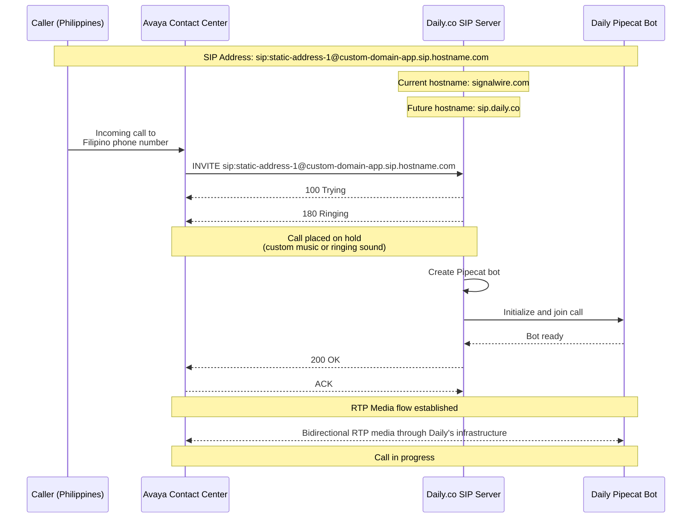
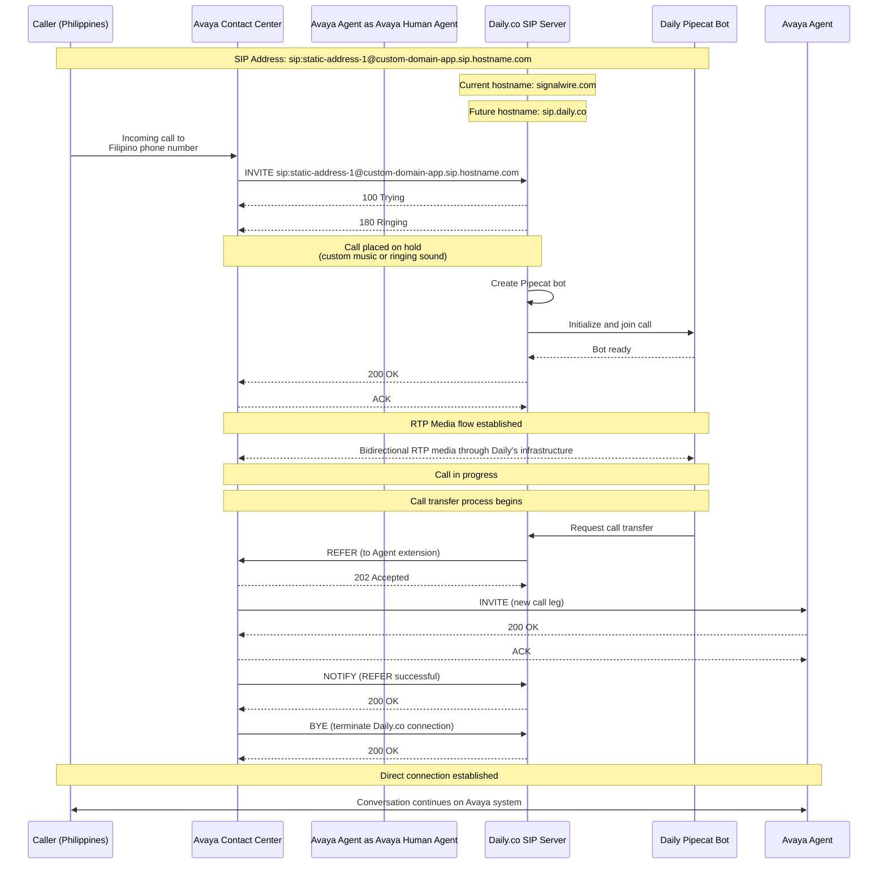

1.Configure a SIP Interconnect on Daily.co. This will allow Avaya to dial-in.
See https://docs.daily.co/reference/rest-api/domainDialinConfig/create-dialin-config

```bash
curl --location --request POST 'https://daily.co/api/v1/domain-dialin-config' --header 'Authorization: Bearer $TOKEN' --header 'Content-Type: application/json' --data-raw '{
	"type": "pinless_dialin",
	"name_prefix": "avaya-interconnect-handler",
	"phone_number": "+12014444444",
	"room_creation_api": "https://host/room-creation-api",
}'
```
This returns the Static SIP header that would be configured on Avaya

```json
    // 200 OK
    {
	"id": "f21fa5eb-f1fd-465d-938c-87f6025a2f39",
	"type": "pinless_dialin",
	"config": {
		"phone_number": null,
		"sip_uri": "sip:static-hash.0@daily-domain.sip.signalwire.com",
		"hmac": "9jyatvPWQfBymCGDOYPYKF/TRZXR+08Gj4bvPF78pH0=",
		"room_creation_api": "https://my-servr-for-room-creation",
 		"name_prefix": "avaya-interconnect-handler",

        }
    }
```

2. RTP features support the following features:
Support both AVP and SAVP profiles, RFC4585 and RFC5104
Support DTLS encryption. It is turned on by default, but it can be disabled, RFC5764 or newer.
Support RTCP multiplexing. It is turned on by default, but it can be disabled. i.e., configured rtcp_mux=false
Support ICE. It is turned on by default, but it can be disabled
Since single audio track, no impact of bundle.
RFC2833/4733 support for DTMF, i.e., in-band telephone tones
G.711 codec: PCMU and PCMA codecs supported, additionally G.722 and G.729 can be supported.

Custom SIP headers are supported as SIP parameters in the SIP URI.
For transfer, we support SIP REFER

3. Bandwidth
PCM Audio is 64 Kbps,
With 10ms packetization interval, this is 150 bytes on the wire, 120 Kbps
With 20ms packetization interval, this is 230 bytes on the wire, 92 Kbps

For 600 calls, the bandwidth requirement will be a max 72 Mbps.
4. Ports
Daily’s SIP can be accessed by Fully Qualified Domain Name routing, i.e., DNS routing. No fixed ports are allocated, resulting in all high port ranges to be used. Since this is dial-in to Daily.co, we do not foresee any issues.


| Protocol | Port Range | Description |
|----------|------------|-------------|
| UDP      | 16384-32768 | Media stream ports |
| UDP      | 40000-49999 | Alternative media stream ports |
| STUN     | 3478-3479   | Session Traversal Utilities for NAT |
| SIP      | 5060        | Standard SIP signaling |
| SIP      | 5070        | SIP signaling |
| SIP      | 5080        | SIP signaling |


SIP Invite
```
INVITE sip:hello@avaya.hostname.com;transport=tls SIP/2.0
Record-Route: <sip:159.65.244.171:5061;transport=tls;lr;ftag=vepXZ0BmK2S3B;nat=yes>
Via: SIP/2.0/TLS 159.65.244.171:5061;branch=z9hG4bKbbec.3a809585f1b39ec38ee4d6246a1210c0.0;i=2a105
Via: SIP/2.0/TLS 138.197.202.4:35181;received=138.197.202.4;rport=37713;branch=z9hG4bKvpHc836Qr79Zc
Max-Forwards: 67
From: <sip:static-hash.0@daily-domain.sip.signalwire.com>;tag=vepXZ0BmK2S3B
To: <sip:hello@avaya.hostname.com>
Call-ID: 8666139d-3c36-4b5a-8a43-3bdf482c328f
CSeq: 91212985 INVITE
Contact: <sip:static-hash.0@138.197.202.4:35181;transport=tls;swrad=138.197.202.4~37713~3>
User-Agent: SignalWire
Allow: INVITE, ACK, BYE, CANCEL, OPTIONS, MESSAGE, INFO, UPDATE, REGISTER, REFER, NOTIFY
Supported: timer, path, replaces
Allow-Events: talk, hold, conference, refer
Session-Expires: 600;refresher=uac
Min-SE: 90
Content-Type: application/sdp
Content-Disposition: session
Content-Length: 3045
X-Relay-Call-ID: 8666139d-3c36-4b5a-8a43-3bdf482c328f
X-SignalWire-CallSid: caf0a36f-f063-4eab-b762-5df540bd7773
Remote-Party-ID: <sip:static-hash.0@daily-domain.sip.signalwire.com>;party=calling;screen=yes;privacy=off

v=0
o=SW 1731522993 1731522994 IN IP4 138.197.202.4
s=SW
c=IN IP4 138.197.202.4
t=0 0
m=audio 10562 RTP/SAVP 0 8 103 101 105
a=rtpmap:0 PCMU/8000
a=rtpmap:8 PCMA/8000
a=rtpmap:18 G729/8000
a=rtpmap:103 opus/48000/2
a=fmtp:103 useinbandfec=1; maxaveragebitrate=30000; maxplaybackrate=48000; ptime=20; minptime=10; maxptime=40
a=rtpmap:101 telephone-event/8000
a=fmtp:101 0-15
a=rtpmap:105 telephone-event/48000
a=fmtp:105 0-15
a=crypto:1 AEAD_AES_256_GCM_8 inline:w+Xr8FeZa3avCEAh0aybKSpGyNcOcOBGHmHc+Cbf59nwviJ5jVee+ku4UHc=
a=crypto:5 AES_256_CM_HMAC_SHA1_80 inline:aDxWycZcKIMYUSzpZwr8jVybatWMDUVrbQLuq0Hz6MfCntJJNb/6O5KQoqIL+A==
a=crypto:7 AES_CM_128_HMAC_SHA1_80 inline:S7+QdirO+X2HO71aZnireS+YtvJHUpNQCaS+JN19
a=crypto:8 AES_256_CM_HMAC_SHA1_32 inline:BIkOUliXKLo4s1r2rAgGZ6ULrEVW4JE7mvqau++rfrvWHl5nkovXcjoiL32jNw==
a=crypto:10 AES_CM_128_HMAC_SHA1_32 inline:UNvtI1i0KOg86nII4B7Q5KOdzsj77KnjQKQXzx00
a=ptime:20
m=audio 10562 RTP/AVP 0 8 103 101 105
a=rtpmap:0 PCMU/8000
a=rtpmap:8 PCMA/8000
a=rtpmap:103 opus/48000/2
a=fmtp:103 useinbandfec=1; maxaveragebitrate=30000; maxplaybackrate=48000; ptime=20; minptime=10; maxptime=40
a=rtpmap:101 telephone-event/8000
a=fmtp:101 0-15
a=rtpmap:105 telephone-event/48000
a=fmtp:105 0-15
a=ptime:20
```






