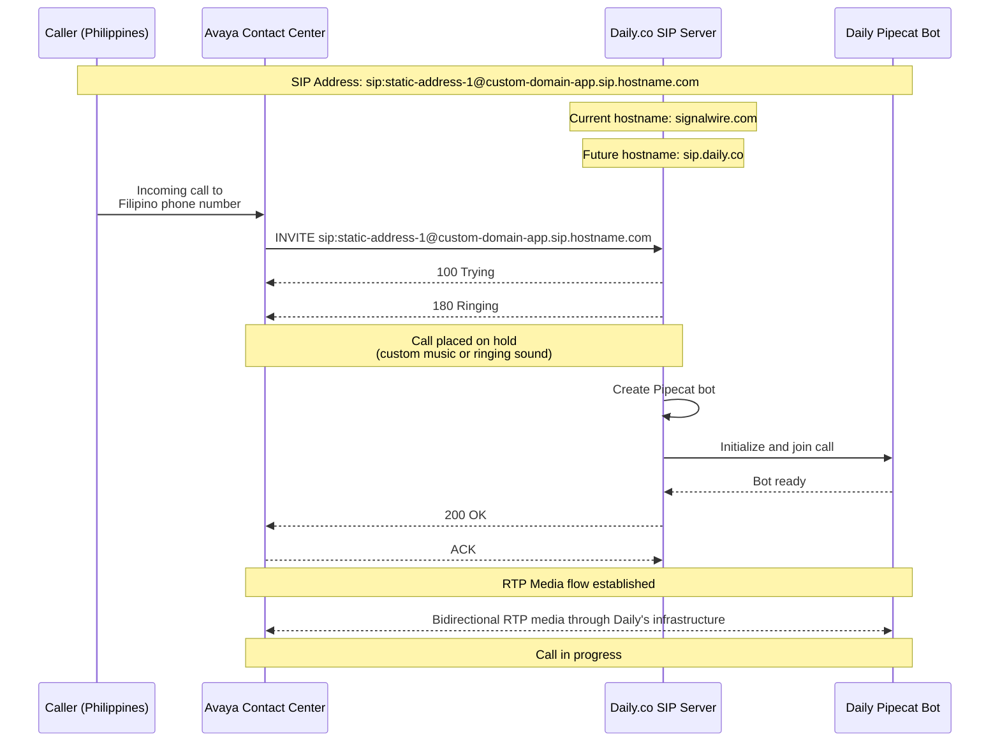
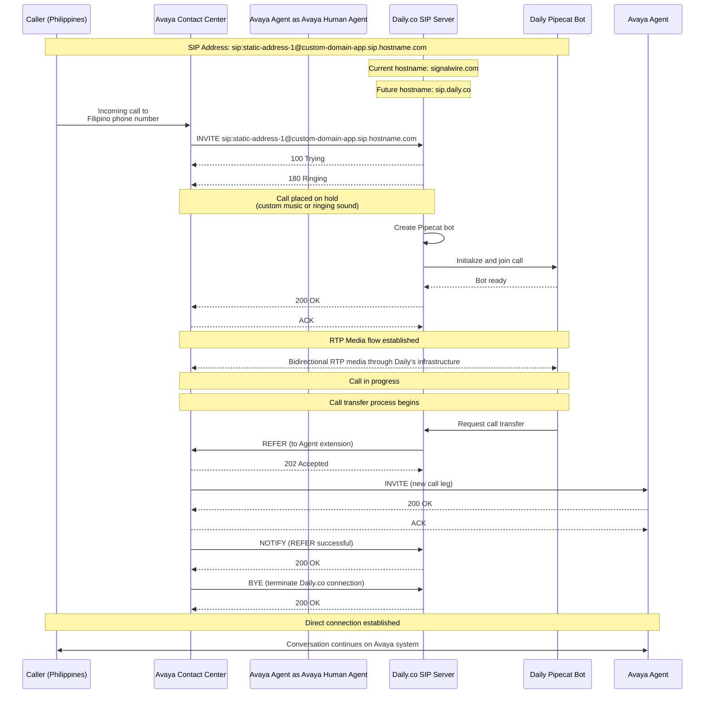

# Daily.co SIP Interconnect Documentation

## Table of Contents
1. [Introduction](#introduction)
2. [SIP Interconnect Configuration](#sip-interconnect-configuration)
3. [Technical Specifications](#technical-specifications)
   - [RTP Features](#rtp-features)
   - [Bandwidth Requirements](#bandwidth-requirements)
   - [Port Requirements](#port-requirements)
4. [SIP Message Examples](#sip-message-examples)
5. [Call Flow Diagrams](#call-flow-diagrams)
   - [Basic Call Flow](#basic-call-flow)
   - [Call Transfer Flow](#call-transfer-flow)

## Introduction

This document outlines the technical specifications and configuration details for establishing a SIP Interconnect between an Avaya Contact Center and Daily.co

## SIP Interconnect Configuration

To establish a SIP Interconnect on Daily.co that allows Avaya to dial in, you need to create a dial-in configuration using the Daily.co REST API. This configuration generates a static SIP address that will be used in the Avaya system.

### Creating a Dial-in Configuration

Use the following API call to create a dial-in configuration on Daily.co:

```bash
curl --location --request POST 'https://daily.co/api/v1/domain-dialin-config' \
--header 'Authorization: Bearer $TOKEN' --header 'Content-Type: application/json' \
--data-raw '{
	"type": "pinless_dialin",
	"name_prefix": "avaya-interconnect-handler",
	"phone_number": "+12014444444",
	"room_creation_api": "https://host/room-creation-api",
}'
```

### Response from Daily.co

Upon successful creation, Daily.co returns a response containing the static SIP address and configuration details:

```json
    // 200 OK
{
	"id": "f21fa5eb-f1fd-465d-938c-87f6025a2f39",
	"type": "pinless_dialin",
	"config": {
		"phone_number": null,
		"sip_uri": "sip:static-hash.0@daily-domain.sip.signalwire.com",
		"hmac": "9jyatvPWQfBymCGDOYPYKF/TRZXR+08Gj4bvPF78pH0=",
		"room_creation_api": "https://my-servr-for-room-creation",
 		"name_prefix": "avaya-interconnect-handler",

  }
}
```

The `sip_uri` value from this response is the Static SIP address that should be configured in your Avaya system. This address allows Avaya to establish SIP connections with Daily.co's platform.

## Technical Specifications

### RTP Features

Daily.co's SIP Interconnect supports a comprehensive set of RTP features to ensure high-quality communication:

- **Protocol Profiles**: Supports both AVP (Audio/Video Profile) and SAVP (Secure Audio/Video Profile), compliant with RFC4585 and RFC5104
- **Encryption**: DTLS encryption is enabled by default (RFC5764 or newer) but can be disabled if required
- **Multiplexing**: RTCP multiplexing is enabled by default, configurable via `rtcp_mux=false` parameter
- **ICE Support**: Interactive Connectivity Establishment is enabled by default but can be disabled
- **Bundle Support**: Since only a single audio track is used, bundle configuration has no impact
- **DTMF Support**: RFC2833/4733 support for in-band telephone tones
- **Codec Support**:
  - G.711 codec (PCMU and PCMA) is fully supported
  - Additional support for G.722 and G.729 codecs is available

Custom SIP headers are supported as SIP parameters in the SIP URI, and SIP REFER is supported for call transfers.

### Bandwidth Requirements

The bandwidth requirements for PCM audio transmission depend on the packetization interval:

- **10ms packetization**:
  - 64 Kbps for PCM Audio
  - 150 bytes on the wire
  - Total bandwidth: 120 Kbps

- **20ms packetization**:
  - 64 Kbps for PCM Audio
  - 230 bytes on the wire
  - Total bandwidth: 92 Kbps

For a deployment handling 600 simultaneous calls, the maximum bandwidth requirement would be approximately 72 Mbps.

### Port Requirements

Daily's SIP service can be accessed using Fully Qualified Domain Name (FQDN) routing through DNS. The service does not allocate fixed ports but uses high port ranges. Since this integration uses dial-in to Daily.co, no port-related issues are expected.

The following ports are used in the SIP communication:

| Protocol | Port Range | Description |
|----------|------------|-------------|
| UDP      | 16384-32768 | Media stream ports |
| UDP      | 40000-49999 | Alternative media stream ports |
| STUN     | 3478-3479   | Session Traversal Utilities for NAT |
| SIP      | 5060        | Standard SIP signaling |
| SIP      | 5070        | SIP signaling |
| SIP      | 5080        | SIP signaling |

## SIP Message Examples

### Example SIP INVITE Message

Below is an example of a SIP INVITE message that is sent from Daily.co to initiate a connection:

```
INVITE sip:hello@avaya.hostname.com;transport=tls SIP/2.0
Record-Route: <sip:159.65.244.171:5061;transport=tls;lr;ftag=vepXZ0BmK2S3B;nat=yes>
Via: SIP/2.0/TLS 159.65.244.171:5061;branch=z9hG4bKbbec.3a809585f1b39ec38ee4d6246a1210c0.0;i=2a105
Via: SIP/2.0/TLS 138.197.202.4:35181;received=138.197.202.4;rport=37713;branch=z9hG4bKvpHc836Qr79Zc
Max-Forwards: 67
From: <sip:static-hash.0@daily-domain.sip.signalwire.com>;tag=vepXZ0BmK2S3B
To: <sip:hello@avaya.hostname.com>
Call-ID: 8666139d-3c36-4b5a-8a43-3bdf482c328f
CSeq: 91212985 INVITE
Contact: <sip:static-hash.0@138.197.202.4:35181;transport=tls;swrad=138.197.202.4~37713~3>
User-Agent: SignalWire
Allow: INVITE, ACK, BYE, CANCEL, OPTIONS, MESSAGE, INFO, UPDATE, REGISTER, REFER, NOTIFY
Supported: timer, path, replaces
Allow-Events: talk, hold, conference, refer
Session-Expires: 600;refresher=uac
Min-SE: 90
Content-Type: application/sdp
Content-Disposition: session
Content-Length: 3045
X-Relay-Call-ID: 8666139d-3c36-4b5a-8a43-3bdf482c328f
X-SignalWire-CallSid: caf0a36f-f063-4eab-b762-5df540bd7773
Remote-Party-ID: <sip:static-hash.0@daily-domain.sip.signalwire.com>;party=calling;screen=yes;privacy=off

v=0
o=SW 1731522993 1731522994 IN IP4 138.197.202.4
s=SW
c=IN IP4 138.197.202.4
t=0 0
m=audio 10562 RTP/SAVP 0 8 103 101 105
a=rtpmap:0 PCMU/8000
a=rtpmap:8 PCMA/8000
a=rtpmap:18 G729/8000
a=rtpmap:103 opus/48000/2
a=fmtp:103 useinbandfec=1; maxaveragebitrate=30000; maxplaybackrate=48000; ptime=20; minptime=10; maxptime=40
a=rtpmap:101 telephone-event/8000
a=fmtp:101 0-15
a=rtpmap:105 telephone-event/48000
a=fmtp:105 0-15
a=crypto:1 AEAD_AES_256_GCM_8 inline:w+Xr8FeZa3avCEAh0aybKSpGyNcOcOBGHmHc+Cbf59nwviJ5jVee+ku4UHc=
a=crypto:5 AES_256_CM_HMAC_SHA1_80 inline:aDxWycZcKIMYUSzpZwr8jVybatWMDUVrbQLuq0Hz6MfCntJJNb/6O5KQoqIL+A==
a=crypto:7 AES_CM_128_HMAC_SHA1_80 inline:S7+QdirO+X2HO71aZnireS+YtvJHUpNQCaS+JN19
a=crypto:8 AES_256_CM_HMAC_SHA1_32 inline:BIkOUliXKLo4s1r2rAgGZ6ULrEVW4JE7mvqau++rfrvWHl5nkovXcjoiL32jNw==
a=crypto:10 AES_CM_128_HMAC_SHA1_32 inline:UNvtI1i0KOg86nII4B7Q5KOdzsj77KnjQKQXzx00
a=ptime:20
m=audio 10562 RTP/AVP 0 8 103 101 105
a=rtpmap:0 PCMU/8000
a=rtpmap:8 PCMA/8000
a=rtpmap:103 opus/48000/2
a=fmtp:103 useinbandfec=1; maxaveragebitrate=30000; maxplaybackrate=48000; ptime=20; minptime=10; maxptime=40
a=rtpmap:101 telephone-event/8000
a=fmtp:101 0-15
a=rtpmap:105 telephone-event/48000
a=fmtp:105 0-15
a=ptime:20
```

This SIP INVITE message includes both the signaling information and the Session Description Protocol (SDP) data that defines the media capabilities for the session.

## Call Flow Diagrams

### Basic Call Flow

The following diagram illustrates the basic call flow between a caller in the Philippines, the Avaya Contact Center, and Daily.co's SIP infrastructure:



### Call Transfer Flow

This diagram shows the complete call flow with transfer to a human agent using SIP REFER:


